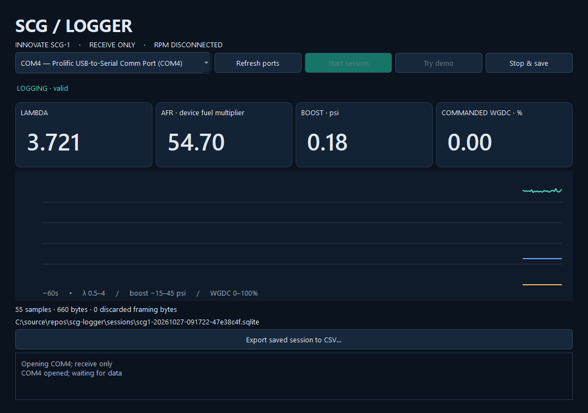

# SCG Logger

A Windows logger for the Innovate SCG-1 wideband and boost controller. It reads
lambda/AFR, boost, and commanded wastegate duty through a USB-to-serial adapter,
saves sessions as it runs, and exports CSV.

LogWorks can stop responding after a disconnect. SCG Logger puts serial work in
a separate process so a stuck port can be closed or the worker restarted without
locking up the dashboard. It has been tested with a Prolific adapter, including
USB unplug/replug recovery.



## Getting started

Requires Windows and 64-bit Python 3.13 with the Python launcher (`py`).

1. Clone or download this repo and run **Setup.cmd**.
2. Connect the SCG-1's serial OUT cable to your adapter.
3. Open **Run.cmd**, select the adapter's COM port, and click **Start session**.
4. Use **Stop & save** when finished, or **Export saved session to CSV** to export.

Close any other application's connection to that port first. **Try demo** lets
you try the dashboard without connecting hardware.

This is a source release; there is no standalone installer yet. The app receives
data only. It does not change controller settings, run calibration, or write to
an ECU. RPM logging is not enabled; the purple RPM wire can stay disconnected.

## Recordings

Sessions are saved in `sessions/` beside the source checkout. A package installed
outside a checkout uses `%LOCALAPPDATA%\SCG Logger\sessions` instead. The window
shows the path of the current recording.

Each session includes raw serial bytes, decoded samples, timestamps, connection
changes, and errors. CSV columns include units, sample quality, and whether the
session was finalized. Missing readings stay blank. AFR uses the fuel multiplier
reported by the controller; WGDC is commanded solenoid duty, not wastegate position.

You can export a running or interrupted session. After a crash, keep any
`.sqlite-wal` and `.sqlite-shm` files beside the `.sqlite` file until you reopen
or export it. Copying just the database while recording can miss committed data.

## Disconnects

Readings go blank after a short pause, and the log records a gap. The app retries
only the selected port and adapter, with a limited retry window. If a serial
operation hangs, the worker can be replaced and the same session continued.
The UI stays available throughout, including **Stop & save**.

After retries run out, start a new session when the adapter is available. If
Windows assigns a different COM number or you move the adapter to another USB
socket, refresh the port list and select it again.

## Development

```powershell
py -3.13 -m venv .venv
.venv\Scripts\python.exe -m pip install -e ".[dev]"
.venv\Scripts\python.exe -m ruff check .
.venv\Scripts\python.exe -m ruff format --check .
.venv\Scripts\python.exe -m unittest discover -s tests -v
```

Tests use fake transports and temporary sessions; no hardware connection is
needed. GitHub Actions runs the checks on Windows. See [CONTRIBUTING.md](CONTRIBUTING.md)
for the code layout and [testing notes](docs/testing.md) for hardware checks.

The [protocol notes](docs/protocol.md) explain the byte layout and channel scales.
[Recovery notes](docs/recovery.md) cover retries, storage, and worker lifetimes.

Currently supports one standalone SCG-1. ECU inputs, external sensors, arbitrary
MTS chains, and a packaged installer are future work. Pressure across its full
range and nonzero WGDC still need a reference comparison.

Licensed under [Apache 2.0](LICENSE).
